# RootOps

**A DevOps-oriented root file manager for Android — with a real PTY terminal, not a pipe.**

RootOps puts the everyday toolkit of an Android power user behind one Compose UI: browse and edit
files the app sandbox normally cannot reach, open a genuine pseudo-terminal, inspect processes,
logcat, mounts and packages, probe the network, run saved scripts on an interval, and reach other
machines over SSH/SFTP.

Every privileged action goes through `su` when it is available and falls back to
`/system/bin/sh` when it is not, so the app stays usable on an unrooted device — it just tells you
what degraded.

`Kotlin` · `Jetpack Compose` · `minSdk 26` · `targetSdk 35` · `arm64-v8a / armeabi-v7a / x86_64`

## Screenshots

Captured on an Android 14 emulator (1080×2340, `sdk_gphone64_x86_64`) during the device QA tour.

| | | |
|:--:|:--:|:--:|
| 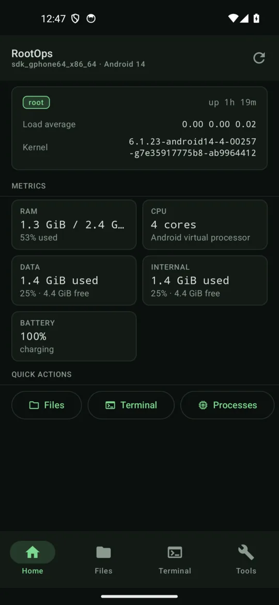 | 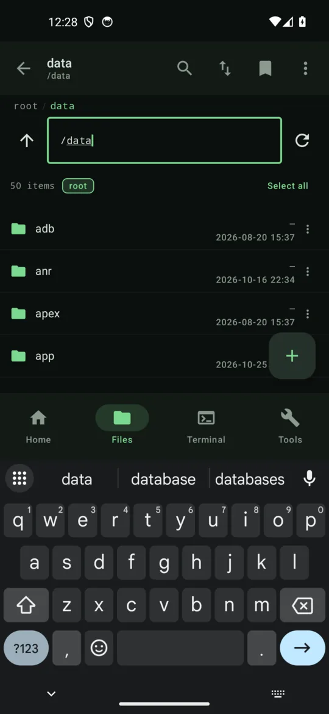 | 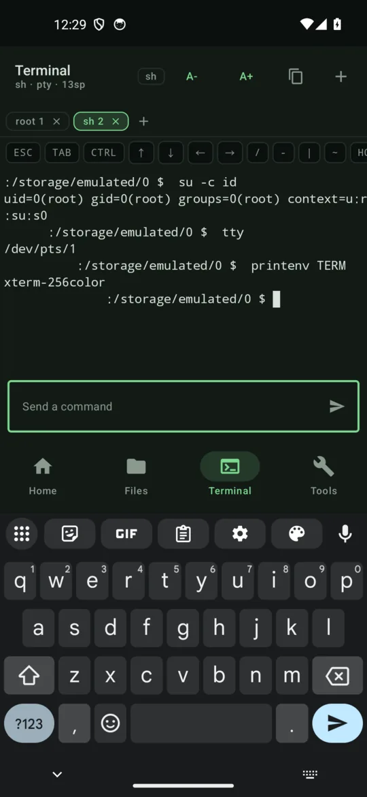 |
| <sub>**Home** — root detected, load average, RAM/CPU, storage, battery</sub> | <sub>**Files** — `/data` listed through root, breadcrumbs and path bar</sub> | <sub>**Terminal** — `su` session on `/dev/pts/1`, `TERM=xterm-256color`</sub> |
| 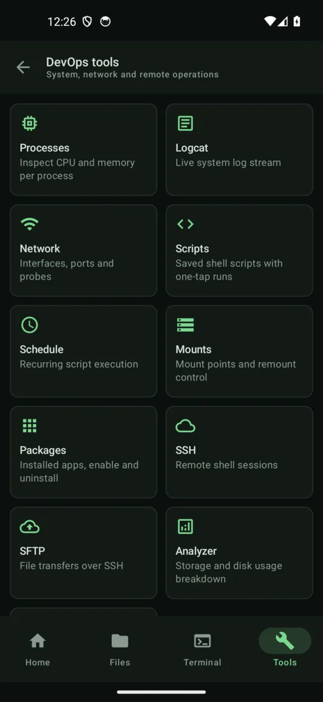 | 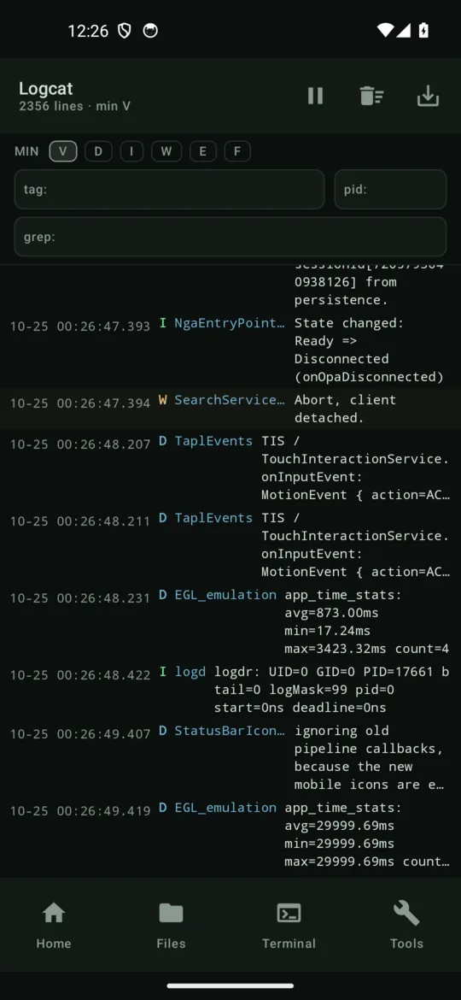 | 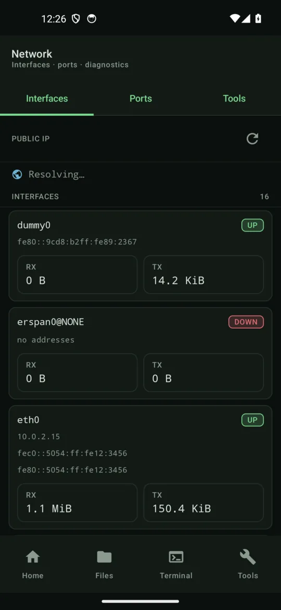 |
| <sub>**Tools** — every system and remote tool in one grid</sub> | <sub>**Logcat** — live `logcat -v threadtime`, level/tag/pid filters</sub> | <sub>**Network** — interfaces with live counters, ports, diagnostics</sub> |
| 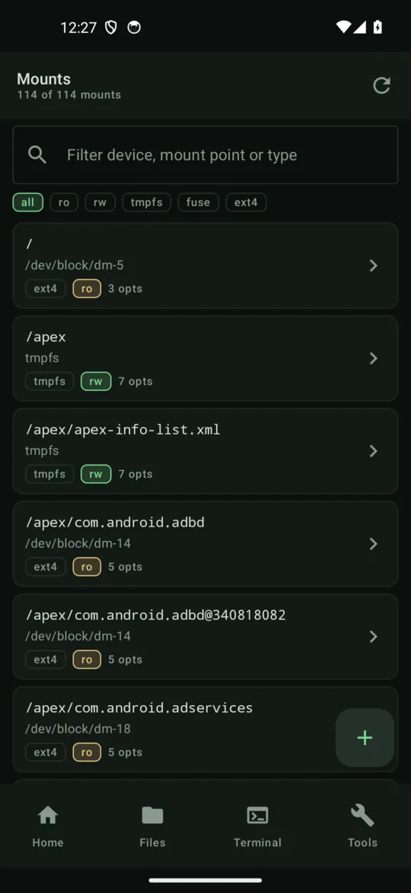 | 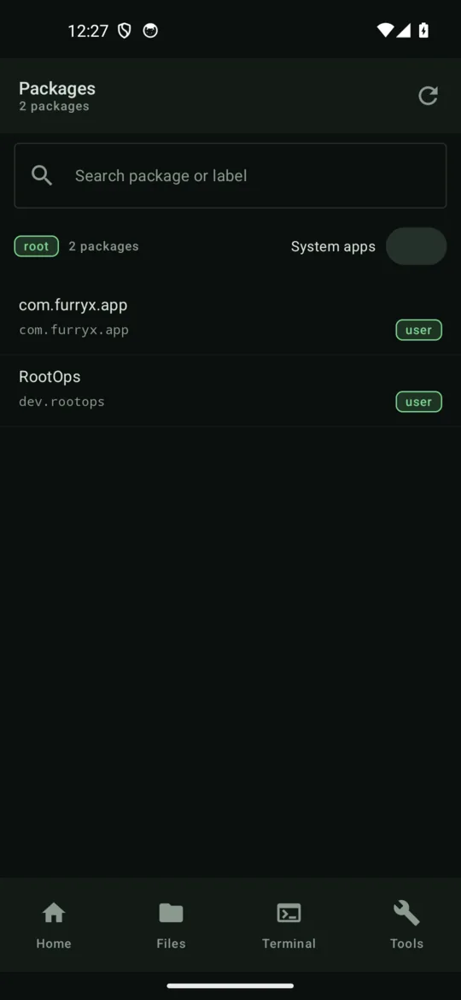 | 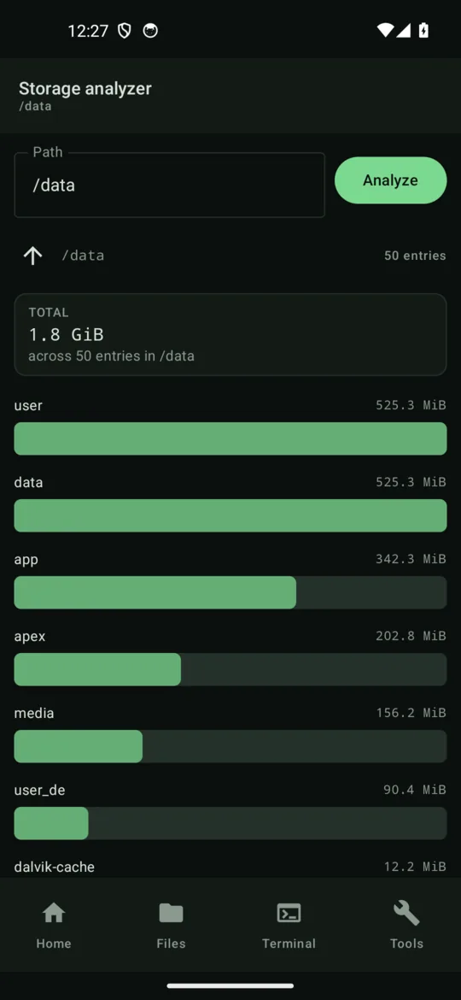 |
| <sub>**Mounts** — `/proc/mounts` entries, remount / mount / umount</sub> | <sub>**Packages** — system and user apps, enable, clear data, uninstall</sub> | <sub>**Analyzer** — `du` breakdown of `/data` (1.8 GiB / 50 entries)</sub> |
| 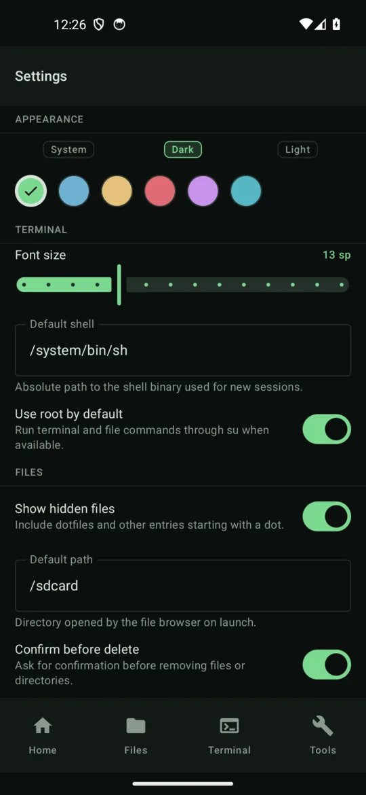 | 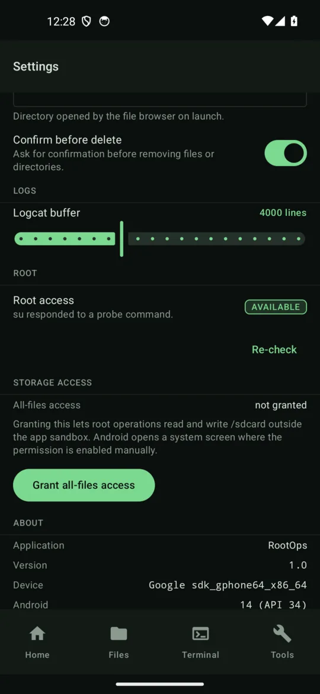 | 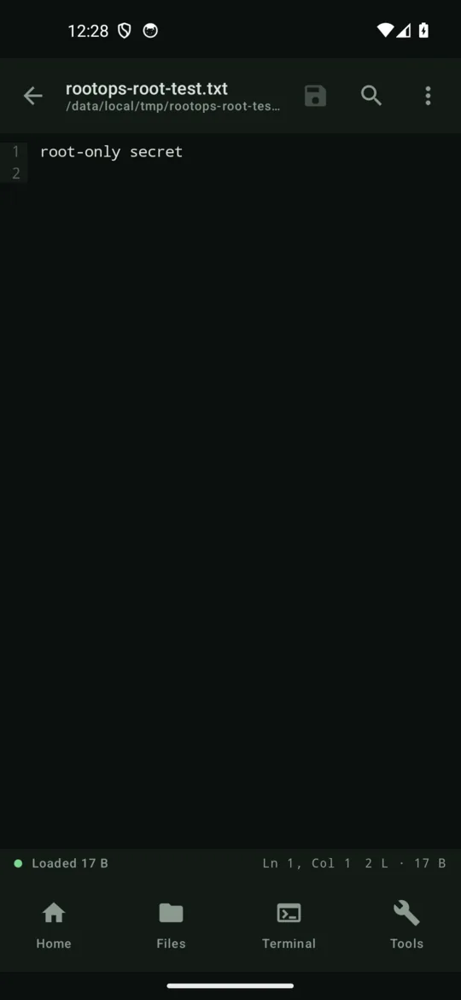 |
| <sub>**Settings** — theme, accent, font, shell, root toggle, paths</sub> | <sub>**Root status** — `su -c id` probe reports AVAILABLE</sub> | <sub>**Editor** — root-only file under `/data/local/tmp`, line gutter, find</sub> |

## Features

### Files & editor

- **Root file browser.** Paths outside the app sandbox (`/data`, `/system`, `/root`, other apps'
  directories) are listed and read through `su`; sandbox-reachable paths use NIO directly.
- Breadcrumb trail plus an editable path bar, hidden-file toggle, sort by name/size/date/type, and
  search either inside the current directory or across the whole device.
- Selection actions: copy, move, delete (with optional confirmation), rename, new folder, new file,
  `chmod`, `chown`.
- Properties: size, mode, owner/group, timestamps, recursive size and child count.
- **Editor** with a line-number gutter, find-next, go-to-line, wrap toggle and copy-all. Saves to
  root-owned paths stage the bytes in a temp file, then `cp` + `chmod`/`chown` so the original mode
  and ownership survive.

### Terminal

- **A real pseudo-terminal.** Each tab forks a shell on a pty pair:
  `posix_openpt` → `grantpt` → `unlockpt` → `setsid` → `TIOCSCTTY` → `execve`. bionic ships no
  `forkpty`, so the sequence is implemented in C (`app/src/main/cpp/pty.c`) and loaded through JNI.
- Raw-mode slave with `TIOCSWINSZ`; the viewport is measured and the pty is resized on rotation and
  font-size changes.
- ANSI/VT parser: SGR colours (16/256/truecolour), cursor addressing, erase, insert/delete,
  save/restore cursor, OSC and a 2,000-line scrollback ring. DEC private modes are accepted but
  inert; scrolling regions (DECSTBM) are not implemented.
- Up to **5 tabs** with a strip that shows the session mode and lets you close or add tabs.
- Extra-key bar for the keys a soft keyboard hides: `ESC`, `TAB`, sticky `CTRL`, arrows,
  `HOME`/`END`, `^C`, `^D`, `/`, `-`, `|`, `~`, paste and clear.
- Environment: `TERM=xterm-256color`, `COLORTERM=truecolor`, `LANG=en_US.UTF-8`. Root sessions
  start `su`, unprivileged ones use the configured shell.
- If the native library cannot load, the same screen falls back to a pipe-backed shell stream
  instead of failing.

### Root shell

- `su -c` is used for every privileged command once a `su -c id` probe returns `uid=0`;
  `/system/bin/sh -c` is used otherwise.
- The probe result is cached in a `StateFlow` and can be re-run from Settings; screens observe it
  and adapt their labels and actions.
- Per-command timeouts, stdout and stderr drained on separate threads, and failures returned as a
  `ShellResult(code, out, err)` — shell problems never throw into the UI.
- Files, logcat, packages, mounts, scripts and the scheduler all share this one runner, so root
  loss is handled in one place.

### System

- **Processes** — CPU/memory percentages, RSS, thread count, user, state, kill with a signal,
  per-process detail.
- **Logcat** — `logcat -v threadtime` streaming with level, tag and PID filters, buffer clear and
  plain-text export.
- **Mounts** — `/proc/mounts` parsing with a `mount` fallback, octal escape decoding, filters,
  remount read-only/read-write, mount and umount (lazy umount as fallback).
- **Packages** — `pm list packages` variants plus `dumpsys package` detail; enable/disable, clear
  data, uninstall (optionally keeping data), launch, APK path.

### Networking

- Interfaces from `ip -o addr` / `ip -o link` with live RX/TX counters, falling back to
  `NetworkInterface` when `ip` is unavailable.
- Listening sockets from `/proc/net/{tcp,tcp6,udp,udp6}` and `ss`, with owner PID mapped back to a
  process name.
- Ping, DNS lookup, HTTP probe with status and timings, public-IP lookup, and traceroute when the
  binary exists on the device.

### Automation

- **Scripts** — name, body, favourite and last-run state kept in `filesDir/scripts.json`; execution
  goes through a root shell handle with streamed output and a recorded exit code.
- **Scheduler** — interval-based jobs persisted across launches. It is deliberately an in-process
  coroutine loop, so nothing runs after Android kills the process; missed intervals are due again
  on the next launch.

### Remote

- **SSH** (JSch) — password or private-key auth (including content URIs), multiple live sessions,
  streamed `exec` output.
- **SFTP** — directory listing, upload/download with progress, mkdir, recursive remove and
  cancellation of an in-flight transfer.
- Host keys are not verified (`StrictHostKeyChecking=no`); see the limitations below.

### Settings

Theme (system/dark/light), accent colour, terminal font size, shell path, use-root toggle, hidden
files, default path, logcat buffer size and delete confirmation.

## Architecture

The UI is a set of thin Compose screens over a single dependency graph. Screens never construct
implementations: they read `AppContainer`, which lazily wires the implementations behind the
interfaces in `core/api/Contracts.kt` and `core/api/Models.kt`.

That interface layer is **frozen**: new behaviour is added behind it, never by forking a second
convention. `docs/CONTRACTS.md` lists the authoritative signatures.

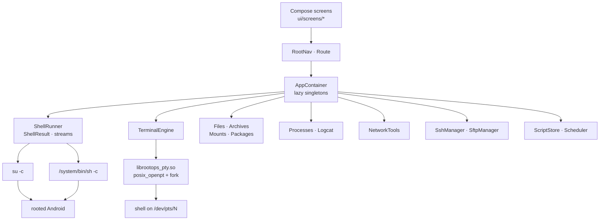

## Build

Requirements:

- JDK 17+
- Android SDK 35 (`compileSdk = 35`)
- Gradle wrapper 8.13, AGP 8.13.0, Kotlin 2.0.21 (already pinned in the repo)
- NDK r29 — **only** if you rebuild the native pty library

```bash
./gradlew :app:assembleDebug
# → app/build/outputs/apk/debug/app-debug.apk
```

The prebuilt `librootops_pty.so` for `arm64-v8a`, `armeabi-v7a` and `x86_64` is committed, so a
plain Gradle build does not need the NDK. Rebuild it only when `pty.c` changes:

```bash
NDK=/opt/android-sdk/ndk/29.0.14206865 scripts/build-native.sh
```

The script compiles `app/src/main/cpp/pty.c` for API 26 with 16 KB page-size compatibility and
writes straight into `app/src/main/jniLibs/<abi>/`.

## Install

```bash
adb install -r app/build/outputs/apk/debug/app-debug.apk
adb shell am start -n dev.rootops/.MainActivity
```

A published build is available at
[RootOps v1.0.0](https://github.com/LangYa466/rootops/releases/tag/v1.0.0).

Root features need a working `su` provider on the device (Magisk, KernelSU, or an equivalent).
Without one the app runs unprivileged.

## Verification

Device run on an Android 14 emulator (`sdk_gphone64_x86_64`), debug build, via
`scripts/qa-tour.py`:

| Check | Result |
| --- | --- |
| Screens toured (Home, Files, Terminal, Tools, Settings, Processes, Logcat, Network, Scripts, Schedule, Mounts, Packages, SSH, SFTP, Analyzer) | 15 PASS |
| Crashes / exception excerpts | 0 |
| Terminal PTY | `/dev/pts/1`, `TERM=xterm-256color`, `uid=0(root)` |
| Root probe | `uid=0(root) gid=0(root) groups=0(root)` |
| Lint | 0 errors, 24 warnings, 4 hints |

The full transcript — per-screen results, manual root checks and the terminal output sample — is in
[`qa/report.md`](qa/report.md). Raw captures are regenerated into `qa/*.png` (git-ignored); the
resized copies used above live in `docs/screenshots/`.

## Known limitations

- **Root is not optional for the interesting parts.** On a real device the app needs Magisk,
  KernelSU or another `su` provider. Without it, root-only paths fail and the UI reports the
  unprivileged state rather than pretending otherwise.
- **SSH/SFTP have not been tested against a live server.** The implementation is complete
  (JSch, password and key auth, transfer progress, cancel), but no remote host was available in
  the test environment.
- **Host keys are not verified** (`StrictHostKeyChecking=no`). Treat SSH/SFTP as a tool for hosts
  and networks you already trust.
- **The pty library is prebuilt for three ABIs only** — `arm64-v8a`, `armeabi-v7a`, `x86_64`.
  Other ABIs fall back to the pipe-backed shell, which has no job control or full-screen apps.
- **The scheduler is in-process.** It uses a coroutine loop, not `AlarmManager`, `WorkManager` or a
  foreground service, so jobs pause when Android kills the process and resume on the next launch.
- **The terminal implements a practical ANSI subset.** Scrolling regions (DECSTBM) are ignored,
  DEC private modes (alternate screen, bracketed paste) are accepted but inert, and there is no
  sixel/kitty graphics support.
- **Mount mutations depend on the device.** Even as root, some kernels and su implementations
  refuse to remount `/system` or `/vendor`; the screen surfaces the failure instead of hiding it.

## Repository layout

```text
rootops/
├── app/
│   ├── src/main/java/dev/rootops/
│   │   ├── core/
│   │   │   ├── api/          Contracts.kt, Models.kt — frozen interface layer
│   │   │   ├── fs/           listings, file ops, archives
│   │   │   ├── shell/        su / sh runner
│   │   │   ├── pty/          JNI bridge, pty session lifecycle
│   │   │   ├── sys/          processes, logcat
│   │   │   ├── net/          interfaces, ports, diagnostics
│   │   │   ├── ssh/          JSch SSH and SFTP
│   │   │   ├── scripts/      script store, interval scheduler
│   │   │   ├── mount/        mount table and mutations
│   │   │   ├── pkg/          package inventory
│   │   │   ├── prefs/        settings store
│   │   │   └── util/         formatting, JSON persistence
│   │   ├── ui/
│   │   │   ├── screens/      one package per screen
│   │   │   ├── components/   shared Compose widgets
│   │   │   ├── nav/          RootNav, Route
│   │   │   └── theme/        colour, type, theme
│   │   ├── AppContainer.kt   process-wide dependency graph
│   │   ├── RootOpsApp.kt
│   │   └── MainActivity.kt
│   ├── src/main/cpp/pty.c    PTY backend (C)
│   └── src/main/jniLibs/     prebuilt librootops_pty.so, three ABIs
├── docs/
│   ├── CONTRACTS.md          frozen API surface
│   ├── PTY.md                PTY design notes
│   └── screenshots/          README images (540 px wide, WebP)
├── scripts/
│   ├── build-native.sh       NDK build for the pty library
│   └── qa-tour.py            adb UI tour that produced qa/
├── qa/
│   ├── report.md             device-run QA report
│   └── *.png                 raw captures (git-ignored)
├── build.gradle.kts
├── settings.gradle.kts
└── gradlew
```
